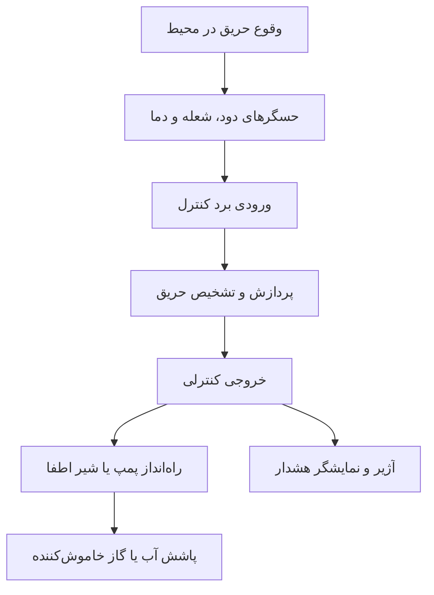
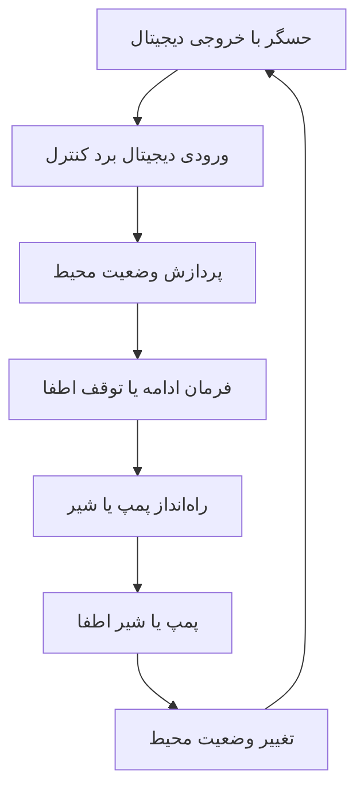
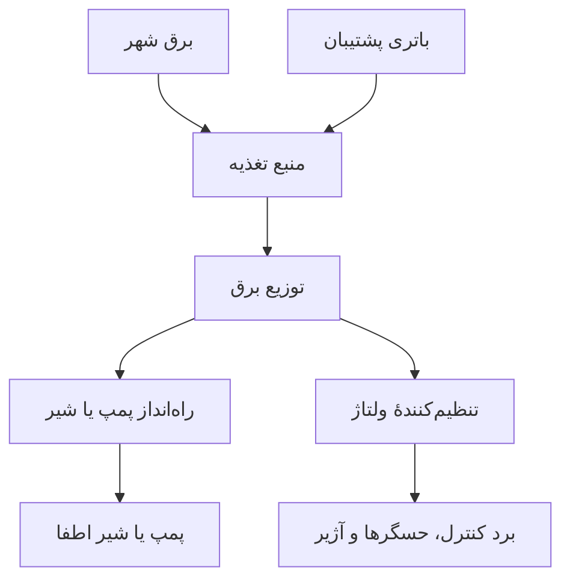

# طراحی سادهٔ سیستم نهفته برای کشف و اطفای حریق هوشمند
نام دانشجویان: امیرعلی بشارتی و پرهام اعتمادی‌نیا  
نام استاد: رسول‌زاده  
موضوع پروژه: طراحی یک سیستم ساده برای کشف و اطفای حریق در یک اتاق است.  
در این سیستم، حسگر دود، حسگر شعله و حسگر دما در نقاط مناسب اتاق نصب می‌شوند.  
یک منبع تغذیه، انرژی موردنیاز سیستم را تأمین می‌کند و یک باتری پشتیبان هنگام قطعی برق وارد کار می‌شود.  
برد کنترل در مرکز سیستم قرار می‌گیرد و وظیفهٔ بررسی دادهٔ حسگرها را دارد.  
اگر برد کنترل حریق را تشخیص دهد، آژیر را روشن می‌کند و پیام هشدار را نمایش می‌دهد.  
سپس برد کنترل، فرمان باز شدن شیر یا روشن شدن پمپ را به راه‌انداز اطفا می‌فرستد.  
این طرح مفهومی، کاربرد سیستم نهفته را در کشف و اطفای هوشمند حریق نشان می‌دهد.

## شکل ۱: مسیر کشف حریق تا اطفا

## شکل ۲: نمونهٔ مسیر دادهٔ حسگر

در این شکل، حسگر از نوع دارای خروجی دیجیتال فرض شده است.

## شکل ۳: مسیر تأمین برق

